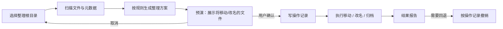
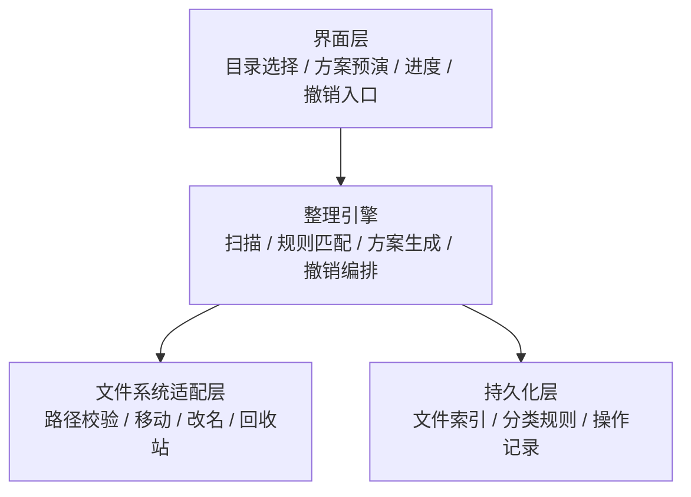

# 00-overview.md · 络雀系统总纲

## 1. 定位

络雀是一个**方便快捷的个人文件整理客户端**：面向本机目录，帮助用户把散乱文件按自己的规则归位，并在需要时整体回退。

| 项 | 内容 |
| --- | --- |
| 目标用户 | 个人用户，本机文件量大、目录长期失序 |
| 运行形态 | 桌面客户端，单机运行 |
| 核心价值 | 快（少配置即可整理）、稳（可预演、可撤销）、透明（每个归类有理由） |
| 非目标 | 多人协作、云端存储、企业级权限管理 |

## 2. 核心流程

流程约束：

- 预演与执行必须是同一份方案，执行时不得静默改变目标路径。
- 操作记录先于文件动作写入；记录缺失时不得执行（HC-10）。
- 任何一步失败都要出现在结果报告中，并标明文件当前实际位置（HC-14）。

## 3. 架构分层

分层规则：

1. 依赖单向：界面层 → 整理引擎 → 文件系统适配层 / 持久化层；反向依赖一律禁止。
2. 整理引擎不依赖任何界面框架，可在无界面环境跑通「扫描 → 方案 → 执行 → 撤销」。
3. 所有文件系统读写只经适配层；适配层负责根目录边界校验与符号链接处理（HC-12）。
4. 分类规则与匹配策略可替换，引擎只依赖规则契约，不内嵌具体规则。
5. 持久化层只存索引、规则与操作记录，不存文件内容副本；删除 / 覆盖走回收站通道（HC-11）。

## 4. 质量属性

| 属性 | 要求 | 验证方式 |
| --- | --- | --- |
| 安全 | 不可逆操作零直达；越界路径零放行 | 预演覆盖测试 + 路径边界用例 |
| 可撤销 | 任一已执行的整理批次可按记录完整回退 | 执行后立即撤销，文件树与操作前一致 |
| 可解释 | 每个文件的归类都能给出命中的规则与理由 | 预演清单逐条展示理由 |
| 性能 | 万级文件目录扫描与方案生成不卡界面 | 长任务进度 + 可取消（HC 与约定 §5） |
| 隐私 | 默认纯本地，不外传文件内容与元数据 | 网络出口审查（HC-13） |
| 可恢复 | 异常中断后重启能识别未完成批次 | 中断恢复用例 |

## 5. 范围边界

**v1 做**：

- 选择整理根目录，递归扫描文件与基础元数据（名称、扩展名、大小、修改时间）。
- 按规则生成整理方案：按类型、按修改日期、按名称模式分组归档。
- 方案预演：展示将移动 / 改名的文件、目标路径、命中理由与影响面。
- 确认执行：写操作记录后执行，支持进度显示与取消。
- 结果报告与撤销：按批次撤销，失败文件可见并可重试。

**v1 不做**：

- 自动删除文件；任何删除必须用户逐次确认并进入回收站。
- 云同步、跨设备、多用户协作。
- 基于文件内容的语义识别或自动打标（依赖外部数据源决策，见 08）。
- 常驻后台自动整理。

**后续候选**：重复文件检测、规则模板与导入导出、定时整理、可选 AI 辅助分类（须先过 08 的 ADR 与 HC-13）。

## 6. 待决事项

技术选型、工程结构、数据存储、外部数据源均未定，候选与触发时机见 [08-adr.md](08-adr.md) §4。决策落地前不得引入具体框架或依赖（`docs/README.md` HC-8）。
