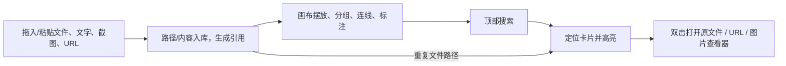
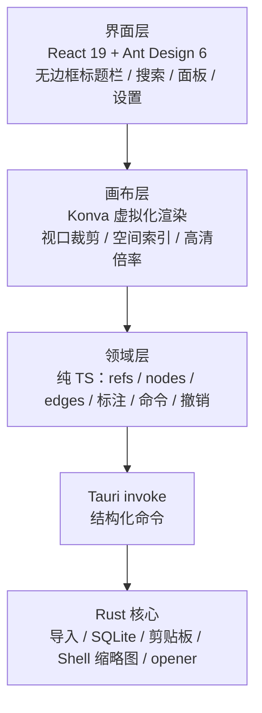

# 00-overview.md · 络雀系统总纲

> 需求基线与验收见 [REQUIREMENTS.md](../REQUIREMENTS.md)；本文件只写定位、架构与范围结论。

## 1. 定位

络雀是一个**本地文件、文字与链接的空间索引画布**：只保存引用，不搬运文件。用户把文件、截图、文字、URL 拖入/粘贴到无限画布，按项目分组、连线、标注，并通过顶部搜索定位。

| 项 | 内容 |
| --- | --- |
| 目标用户 | 工程材料、方案、合同等文件量大，需要空间化梳理的个人用户 |
| 运行形态 | Tauri 2 桌面客户端，Windows 优先，单机运行 |
| 核心价值 | 轻（安装/启动负担低）、快（搜索即定位）、稳（原文件不动）、透明（失败可见） |
| 非目标 | 云端、协作、AI 分类、文件搬运 |

## 2. 核心流程

约束：

- 文件引用只存路径与展示元数据，不复制文件内容。
- 重复文件导入不新建卡片，直接定位已有卡片。
- 原文件不移动、不改名、不删除；打开/定位只通过引用 ID。

## 3. 架构分层

分层规则：

1. 依赖单向：界面/画布 → 领域 → IPC → Rust；反向禁止。
2. 领域层不依赖 React、Konva、Tauri；画布层不直接访问文件系统。
3. Rust 是唯一接触文件系统、剪贴板、SQLite、Shell 缩略图的层。
4. 画布只渲染可见节点；场景数据在普通 TS store，不以 Konva 节点树作为真相源。
5. 所有路径在 Rust 侧解析、校验、入库；前端只拿引用 ID 与展示元数据。

> 画布渲染层为 Konva + rbush（视口裁剪 + 高清倍率），面向十万级引用；场景数据在普通 TS store，与渲染层解耦。

## 4. 质量属性

| 属性 | 要求 | 验证方式 |
| --- | --- | --- |
| 心智负担 | 导入不弹窗、重复自动定位、搜索即定位、自动保存 | 关键路径无模态框；重复导入一次定位 |
| 密度 | 72px 宽图标格、高度自适应；1440×900、100% 缩放、详情收起时同屏 ≥100 个引用 | 1000 条模拟引用；同屏计数 |
| 性能 | 数千节点流畅；十万级引用可检索、可浏览 | 视口裁剪；1 万节点基准；10 万容量基准 |
| 安全 | 只读引用；不越出显式导入边界；不跟随符号链接越界 | 路径边界用例；打开/定位只接受 refId |
| 隐私 | 纯本地；不上传文件内容/元数据；URL 仅系统浏览器打开 | 网络出口审查 |
| 可恢复 | SQLite WAL + 事务；异常可重建工作空间 | 崩溃后重启；损坏后重建 |
| 轻量 | 安装包与启动开销显著低于 Electron | 安装包体积、冷启动计时 |

## 5. 范围边界

**v1 做**：

- 无限画布、文件/文件夹/文字/截图/URL 导入、文件路径去重、重复定位。
- Windows 桌面式高密度系统图标网格；分组按内容收高；无边框自定义标题栏（logo、居中搜索、窗口按钮）；顶部搜索常驻。
- 语义色令牌与四套可切换浅色主题；默认灰雾紫，主题选择本地持久化。
- 文件/图片/链接/文字/空间卡片；有向连线；结构化标注。
- 顶部模糊搜索、拼音首字母、定位高亮、打开原文件/URL/图片查看器、资源管理器定位。
- 对象与空间不重叠、拖动对齐参考线与自动吸边、空间内自动整理。
- `dataWorkSpace` 本地存储与设置迁移；系统缩略图/图标。
- 不可见暂停渲染、十万级容量架构。

**v1 不做**：

- 文件移动/改名/删除；递归扫描；全盘索引；文件内容索引/OCR。
- 云端、协作、AI、遥测；内嵌视频播放；自由手绘；多画布。
- 视频封面提取；图片预览自定义协议。
- 复杂容灾与自动备份。

**后续候选**：多画布、自由涂鸦、视频内嵌播放、工作空间导出、macOS/Linux。

## 6. 关键决策

见 [08-adr.md](08-adr.md)：Tauri 2 + React 19.3.1 + Ant Design 6.6.7、单体工程、SQLite + `dataWorkSpace`、纯本地、Konva 虚拟化画布、只读引用、文件级去重、窗口与渲染生命周期、Windows 桌面式图标网格、语义色多主题、Windows Shell 缩略图。
