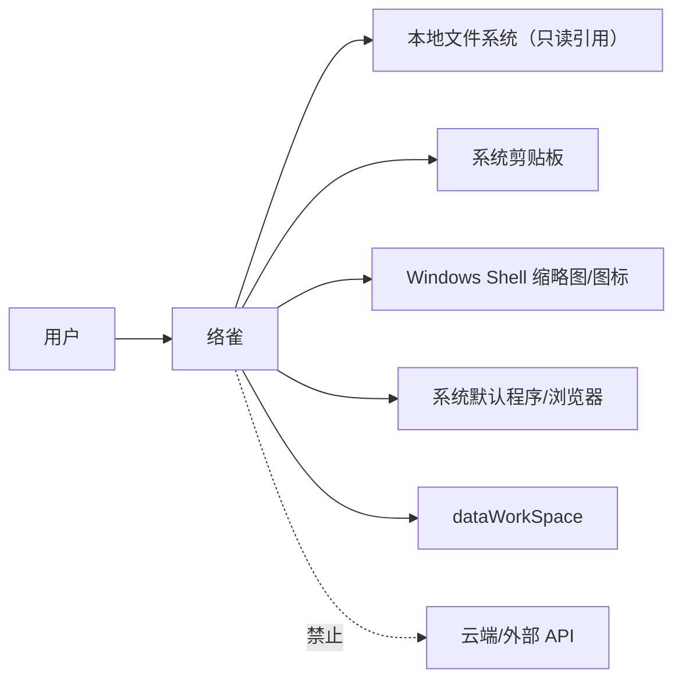

# 01-system-context.md · 系统上下文

## 1. 参与者与外部系统

| 对象 | 关系 |
| --- | --- |
| 用户 | 拖入/粘贴文件与内容；搜索、定位、打开 |
| Windows 资源管理器 | 拖拽来源；复制文件；在资源管理器中定位 |
| 系统剪贴板 | 文件路径、文字、截图 |
| 系统 Shell | 文件缩略图/图标；默认程序打开文件 |
| 系统浏览器 | 打开 URL |
| `dataWorkSpace` | SQLite、资源副本、缩略图缓存、日志 |
| 云端 | 无 |

## 2. 边界

- 应用不写用户文件；只写 `dataWorkSpace`。
- 应用不访问网络；URL 交给系统浏览器。
- 应用不扫描未显式导入的目录；拖入文件夹只生成一个文件夹引用。
- 前端 WebView 不直接获得文件系统权限；所有文件访问经 Rust 命令。
