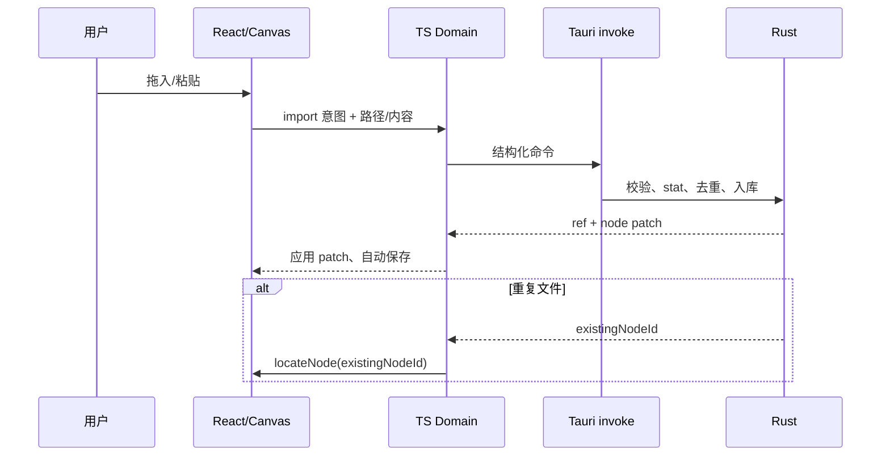

# 02-client-architecture.md · 客户端架构

## 1. 运行时

- Tauri 2 + Rust 核心 + Windows WebView2。
- React 19.3.1 + TypeScript 6.0.3 + Ant Design 6.6.7 负责界面；Vite 8.3.5 构建。
- 画布渲染层为 Konva 10 + react-konva 19.3.2，配 rbush 空间索引做视口裁剪与三档 LOD。
- 单窗口、单进程模型；无本地 HTTP 服务，不建端口表。
- SQLite 由 Rust 侧 `rusqlite` 持有，前端不直接执行 SQL。

## 2. 分层与职责

| 层 | 职责 | 禁止 |
| --- | --- | --- |
| 界面层 `client/components` | React 组件：顶栏搜索、面板、设置、提示 | 直接读文件/数据库 |
| 画布层 `client/canvas` | 视口、空间索引、可见节点渲染、LOD、交互 | 作为场景真相源 |
| 领域层 `client/domain` | 引用/节点/边/标注模型、命令、撤销、定位、搜索编排 | 依赖 React/Konva/Tauri |
| 桥接层 `client/shared` | DTO、命令契约、Tauri invoke 封装 | 业务规则 |
| Rust 核心 `desktop` | 文件系统、剪贴板、SQLite、Shell 缩略图、打开/定位 | 依赖前端框架 |

依赖方向：界面/画布 → 领域 → 桥接 → Rust。领域层通过端口接口调用桥接，测试时可替换。

主题由界面层统一提供语义色快照，Ant Design 与 Konva 读取同一套令牌，不各自维护色板。切换主题只更新绘制参数，不修改场景数据，不重建撤销栈。

## 3. 数据流



- 拖拽过程只在本地预览；`dragend` 提交一次，不按帧 IPC。
- 文本编辑防抖提交；视口变化防抖保存。
- 首屏加载紧凑场景索引；可见节点详情、缩略图与标注按需拉取。
- 撤销栈在领域层；删除卡片同时删除引用与关联边/标注目标，事务内完成。

## 4. 画布与性能

- 场景数据用普通 TS 数组/Map 保存，不使用深层响应式。
- 首屏只加载紧凑场景索引（id/type/refId/坐标/尺寸/父子/层级），不加载全部文件元数据与缩略图。
- 可见节点的引用详情、标注详情按需批量拉取；离开视口后释放详情与图片。
- `rbush` 空间索引按视口查询可见节点与边。
- 只给可见节点创建 Konva 形状；离屏节点不创建、不更新。
- LOD 三档：
  - 远景（低于 50%）：类型色点，不绘文字与系统图标。
  - 中景（50%–70%）：简化系统图标 + 单行名称。
  - 近景（70% 以上）：完整系统图标 + 最多两行名称；路径与完整内容仍由 Tooltip 展示。
- 迷你地图只用紧凑索引绘制简化色块，不复用完整卡片。
- 缩略图只在可见且停留超过阈值时加载，缓存到 `dataWorkSpace/thumbnails`。
- 渲染按需：无动画时停止 `requestAnimationFrame`；窗口隐藏/最小化/失焦时暂停绘制与加载。
- 边只绘制与可见节点相连或穿过视口的部分；箭头使用批量绘制。
- 容量目标：存储 10 万引用；同屏绘制控制在数百到两千个对象。

## 5. 窗口生命周期

- 标准窗口：`decorations: false` 无边框；48px 自定义标题栏承载 logo、居中搜索、新建文字、设置与最小化/最大化/关闭。
- 标题栏空白区域标记 `data-tauri-drag-region`，由 Tauri 原生拖动窗口；按钮与输入区域不触发拖动（`core:window:allow-start-dragging`）。
- 窗口按钮调用 Tauri 窗口 API，权限在 `capabilities/default.json` 显式声明。
- F12 通过 Rust 命令 `open_devtools` 打开 WebView 开发者工具；`tauri` 启用 `devtools` feature，release 构建同样可用。
- 桌面常驻（可选，默认关闭）：窗口置底/桌面层，适合当作桌面工具。
- 最小化/隐藏：暂停渲染、动画、缩略图请求；不退出进程。
- 关闭：退出进程；默认不做托盘常驻。
- 监听窗口聚焦/失焦/尺寸/可见性事件，由 Rust 或 Tauri 窗口事件通知前端。

## 6. IPC 契约（当前实现）

| 命令 | 输入 | 输出 |
| --- | --- | --- |
| `workspace_get` | 无 | dataWorkSpace 路径、DB 路径、节点数、占用大小 |
| `scene_load` | 无 | 全部节点/分组/边/标注 |
| `scene_save` | `SceneData` | 成功/失败；按 ID 增量 upsert，事务内清理快照外的对象 |
| `import_paths` | 路径数组、x/y | created / existing / errors |
| `read_clipboard_files` | 无 | Windows CF_HDROP 文件路径数组 |
| `save_clipboard_image` | base64、扩展名 | 本地 asset 路径 |
| `preview_ref` | nodeId | 图片 data URL（≤24MB） |
| `open_ref` | nodeId | 打开原文件 / URL |
| `reveal_ref` | nodeId | 在资源管理器中定位 |
| `node_get` | nodeId | 单个节点（重复导入后定位刷新） |
| `thumb_get` | nodeId、size | Shell 缩略图 data URL；不可用返回 `null` |
| `ref_check` | nodeId 数组（空=全量） | 各引用的 `is_exists` / `size` / `mtime`，写回数据库 |
| `ref_relink` | nodeId、新路径 | 更新后的节点与状态；命中去重索引时报错 |
| `meta_get` / `meta_set` | key、value | `app_meta` 配置读写（主题、桌面常驻等） |
| `workspace_open` | 无 | 在资源管理器中打开工作空间目录 |
| `workspace_rebuild` | 无 | 清空业务数据，保留 `assets`/`thumbnails` |
| `workspace_migrate` | 目标目录 | 复制-校验-切换后的工作空间信息；失败保留旧目录 |
| `pick_file` / `pick_folder` | 无 | 系统文件/目录选择对话框；取消返回 `null` |
| `window_set_pin` | pinned | 桌面常驻：窗口压到普通窗口之下 |
| `open_devtools` | 无 | F12 打开开发者工具 |

- 前端只传 `nodeId` 给打开/定位命令，路径由 Rust 查库；不暴露任意路径。
- `scene_save` 不暴露 SQL；前端只提交结构化场景。
- 缩略图、预览协议、搜索索引后续补充。

## 7. 源码分层（已建）

```text
ploceusTidy/
├── desktop/                    # Tauri 2 / Rust；纯桌面，无 iOS/Android
│   ├── Cargo.toml / Cargo.lock
│   ├── build.rs
│   ├── tauri.conf.json
│   ├── capabilities/default.json
│   ├── icons/
│   └── src/
│       ├── main.rs
│       ├── lib.rs              # 命令注册、窗口 setup
│       ├── db.rs               # SQLite、场景加载/保存、导入去重
│       ├── models.rs           # IPC DTO
│       └── platform.rs         # 路径规范化、文件类型、剪贴板文件
├── client/                     # React 前端
│   ├── index.html
│   ├── main.tsx
│   ├── App.tsx
│   ├── vite-env.d.ts
│   ├── lib/tauri-api.ts
│   ├── lib/theme.ts             # 四套主题语义令牌
│   ├── lib/search.ts            # 搜索归一化与排序
│   ├── types/scene.ts
│   ├── components/
│   │   ├── TitleBar.tsx
│   │   ├── CanvasBoard.tsx      # Konva 渲染层
│   │   ├── SystemIcon.tsx
│   │   ├── DetailsPanel.tsx
│   │   ├── ImagePreviewDialog.tsx
│   │   └── SettingsDialog.tsx
│   ├── styles/global.css
│   ├── domain/                 # 规划：纯 TS 实体、命令、撤销、定位
│   └── shared/                 # 规划：Tauri IPC 契约
├── package.json
├── vite.config.ts
├── tsconfig.json / tsconfig.app.json / tsconfig.node.json
├── eslint.config.js
├── prettier.config.cjs
├── .editorconfig
├── dataWorkSpace/              # 运行时生成，不入库
├── docs/
└── assets/
```

- 当前客户端：`CanvasBoard.tsx` 用 React DOM 只渲染可见行；M2 将场景模型接入 Konva。
- 文件命名：React 组件 PascalCase，TS 模块 kebab-case，Rust 模块 snake_case；图表、字段名保留原文。

## 8. 依赖与理由

| 依赖 | 用途 | 理由 |
| --- | --- | --- |
| Tauri 2 | 桌面壳 | 轻量、安装小、Rust 平台能力 |
| React 19.3.1 + TS | 界面与领域 | 用户选定；类型安全、组件生态 |
| Ant Design 6.6.7 | 顶栏、弹窗、图片预览、表单、Switch | 统一交互与可访问性 |
| @ant-design/icons 6.3.4 | 界面图标 | 与 Ant Design 一致 |
| Vite 8.3.5 + @vitejs/plugin-react 6.1.2 | 开发与构建 | 最新稳定版，开发反馈快 |
| Konva（M2） | 画布绘制 | Canvas 2D、变换、命中、批量绘制；可做虚拟化 |
| rbush（M2） | 空间索引 | 视口查询；十万级节点必需 |
| rusqlite（M1） | SQLite | 单文件、事务、WAL；DB 留在 Rust |
| uuid（M1） | 自定义 ID | 主键与关联键统一 UUID TEXT |
| image（M1） | 剪贴板图片缩略图 | 截图资源解码与缩放 |
| clipboard-win（M1） | Windows 文件剪贴板 | CF_HDROP 文件列表 |
| windows crate（M1） | Shell 缩略图/图标 | IShellItemImageFactory / SHGetFileInfoW |
| tauri-plugin-opener（M1） | 打开/定位 | openPath / revealItemInDir |
| tauri-plugin-dialog（M1） | 重新关联文件、工作空间迁移 | 原生文件/目录选择器 |
| konva 10 + react-konva 19.3.2 | 画布渲染层 | 节点/连线/分组/LOD 绘制 |
| rbush 4 + @types/rbush | 视口空间索引 | 可见节点裁剪查询 |
| windows 0.61 + image 0.25 | Shell 缩略图、窗口置底 | IShellItemImageFactory / SetWindowPos；image 仅用于 PNG 编码 |

> 不引入 React Flow：DOM 节点在万级规模不可控。画布引擎见 ADR-005，已用 Konva + rbush 落地。

> 版本基线：React 19.3.1、React DOM 19.3.1、Ant Design 6.6.7、`@ant-design/icons` 6.3.4、Vite 8.3.5、`@vitejs/plugin-react` 6.1.2、TypeScript 6.0.3。TypeScript 7.0.2 与 `typescript-eslint` 8.72 的 peer 上限 `<6.1.0` 冲突，暂不使用。

## 9. 性能预算

- 1 万引用：冷启动加载 ≤ 1s；搜索 ≤ 100ms；平移缩放 ≥ 50fps。
- 10 万引用：冷启动加载 ≤ 3s；搜索 ≤ 300ms（后续 FTS5/内存索引）；同屏绘制 ≤ 2k 对象。
- 缩略图：仅可见节点；单次并发 ≤ 4；失败不阻塞。
- 渲染：窗口不可见时停止 RAF；无交互动画时不重绘。
